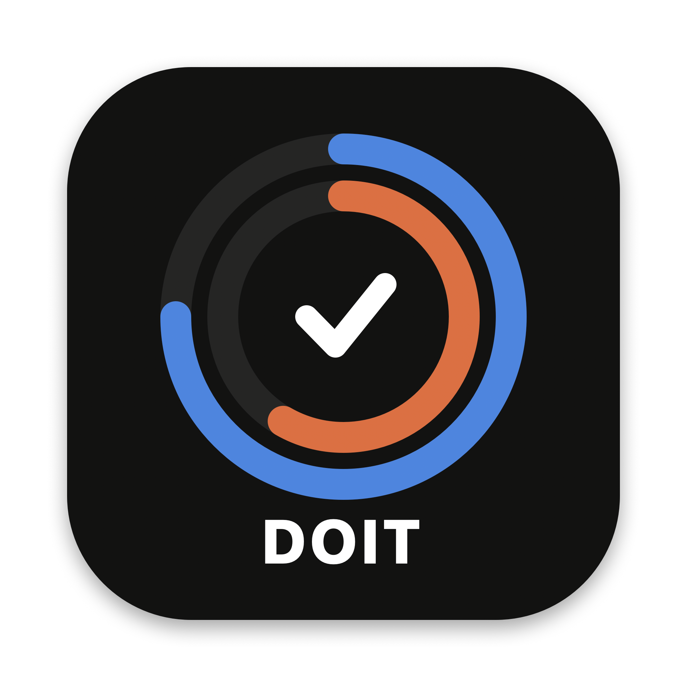

# DOIT

An 8-week interview-prep plan for macOS. Every day it tells you what to work on: about **50 minutes of LeetCode** and **50 minutes of system design**. It also tracks your streak, your hours, and how well you know each topic.



## Install (macOS)

You need [Node.js](https://nodejs.org) 20.19 or newer. Works on Apple Silicon and Intel Macs.

```bash
git clone https://github.com/aaenperez/DOIT.git
cd DOIT
npm install
npm run install-app
```

This builds `DOIT.app` for your Mac and copies it to `/Applications`. Open it from Launchpad or Spotlight and drag it to your Dock.

On first launch you choose:
- **When to start**: today, tomorrow, next Monday, or a date you pick.
- **Where to start on LeetCode**: from the very beginning (Contains Duplicate), or skipping the first 6 Arrays & Hashing problems if you've already done them.

To update later, run `git pull && npm install && npm run install-app`. Your progress is kept.

## What's inside

- **Today** shows today's LeetCode problems and system design topic.
  - Each problem has its pattern, target complexity, a problem link and an explanation video.
  - The system design topic has 2–3 free study links, questions to answer out loud, an exercise and key terms.
  - Each block has a timer, and logging takes one click.
- **Calendar** is a month view. Finished days turn green. Missed days push the plan back instead of disappearing.
- **Progress** has your streak, hours, LeetCode vs system design split, a daily minutes chart, per-topic progress, and the system design topics you rated low.
- **Roadmap** shows all 56 days. Click any day to open it.

The plan:
- **LeetCode** follows the NeetCode 150 topic order: arrays → two pointers → sliding window → stack → binary search → linked lists → trees → heaps → backtracking → graphs → DP → intervals. Then come extra problems and a week of timed mock sets.
- **System design** starts from zero:
  - Weeks 1–3 cover fundamentals.
  - Weeks 4–7 cover 24 classic design problems.
  - Week 8 is mock interviews.
- **Every 7th day is a review day.** It brings back every problem you solved with hints, only studied, or skipped.

## Your data

Progress is stored locally in `~/Library/Application Support/DOIT/progress.json`, never in the repo or online. The sidebar has a button that shows the file in Finder. To start over, quit the app and delete that file.

## Development

```bash
npm start            # build and run without packaging
npm run package      # build release/DOIT-darwin-<arch>/DOIT.app without installing
```

- `src/data/lc-plan.js` has the LeetCode problems and both day-by-day tracks.
- `src/data/sd-curriculum.json` has the 56-day system design curriculum.
- `src/lib/model.js` has the plan logic: review queue, projections, streaks and stats.
